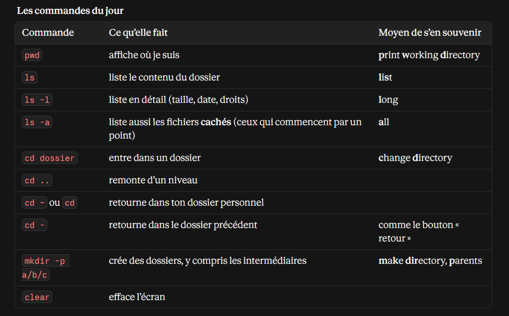

Commande       |	Ce qu’elle fait	| Moyen de s’en souvenir
pwd	           | affiche où je suis	| print working directory
ls	           | liste le contenu du dossier | list
ls -l	       | liste en détail (taille, date, droits)	| long
ls -a	       | liste aussi les fichiers cachés (ceux qui commencent par un point)	|all
cd             | dossier	entre dans un dossier	| change directory
cd ..	       | remonte d’un niveau	
cd ~ ou cd     |	retourne dans ton dossier personnel	
cd -	       | retourne dans le dossier précédent	comme le bouton « retour »
mkdir -p a/b/c |	crée des dossiers, y compris les intermédiaires	| make directory, parents
clear	       |efface l’écran	

---------------------------------------------------------------------------------------------

Tu es dans /home/sarah/formation/semaine1/notes. 

- Après cd .., que renvoie pwd ?: /home/sarah/formation/semaine1
- Depuis notes, après cd ../../semaine2, où es-tu ? /home/sarah/formation/semaine2
- Quelle est la différence entre cd ~ et cd / ? cd~ me ramène dans mon dossier personnel or cd/ dans le dossier racine.
- Lesquels de ces chemins sont absolus, lesquels relatifs : /home/stevi/formation : absolu, semaine1/notes: relatif, ../semaine2: relatif, ~/formation: absolu ?
- Ton dépôt Git contient un dossier .git et un fichier .gitignore. Pourquoi ne les vois-tu pas avec un simple ls ? Parce que ls ne permet pas d'afficher des fichiers cachés. Il faudrait plutôt ls -a.
- Pourquoi rien ne s’affiche quand tu tapes ton mot de passe avec sudo ? c'est une mesure de sécurité linux.